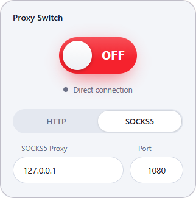

# ⚡ Proxy Switch

**One-click HTTP / SOCKS5 proxy switcher for your browser.**
Flip the switch. Route your traffic. Flip it back. No menus, no fuss.

---

## ✨ Features

- 🔴🟢 **One-click toggle**: turn your proxy ON/OFF instantly from the toolbar popup
- 🔀 **HTTP & SOCKS5** support with a clean segmented switcher
- 💾 **Separate saved profile per protocol** (host + port remembered)
- ✅ **Input validation** for host and port
- 🪶 **Lightweight**: no tracking, no analytics, no external requests
- 🔒 **Minimal permissions**: only `proxy` and `storage`

## 🌐 Supported Browsers

| Browser | Package |
|---------|---------|
|  Brave   | `proxy-switch-brave.zip` |
|  Chrome  | `proxy-switch-chrome.zip` |
|  Edge    | `proxy-switch-edge.zip` |
|  Opera   | `proxy-switch-opera.zip` |
|  Firefox | `proxy-switch-firefox-1.1.0.xpi` |

## 📥 Installation

### Chromium browsers (Brave / Chrome / Edge / Opera)

1. Download the zip for your browser from the [**Releases**](../../releases) page and extract it.
2. Open the extensions page:
   - Brave: `brave://extensions`
   - Chrome: `chrome://extensions`
   - Edge: `edge://extensions`
   - Opera: `opera://extensions`
3. Enable **Developer mode**.
4. Click **Load unpacked** and select the extracted folder.
5. Pin the extension 📌 and you're done!

### Firefox

1. Download the `.xpi` file from [**Releases**](../../releases).
2. Open it in Firefox (or drag it into `about:addons`) and confirm the install.

## 🚀 Usage

1. Click the extension icon.
2. Choose **HTTP** or **SOCKS5**.
3. Enter your proxy host and port (defaults: `127.0.0.1:8085` for HTTP, `127.0.0.1:1080` for SOCKS5).
4. Hit the big switch. 🔥

## 🗺️ Roadmap

- [x] HTTP proxy support
- [x] SOCKS5 proxy support
- [x] Per-protocol saved profiles
- [ ] 🔐 **HTTPS proxy** support
- [ ] 🔗 **Proxy URL / PAC script** (automatic proxy configuration URL)

Have an idea? [Open an issue](../../issues/new) 💡

## 📄 License

Distributed under the **MIT License**. See [`LICENSE`](LICENSE) for details.

Made with ❤️ · If you like it, drop a ⭐

